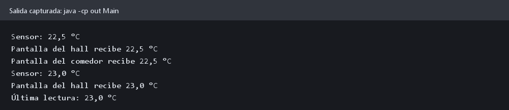

# Ejercicio 1 - Notificador de cambio de temperatura

El sensor mantiene observadores genéricos, notifica al actualizarse y permite
desuscribir pantallas. La segunda lectura confirma que la pantalla retirada ya
no recibe eventos.



La imagen reproduce la salida estándar de una ejecución real de `Main`.
Requiere Java 17 o posterior. Desde esta carpeta, compile y ejecute:

```powershell
javac -d out src\Main.java
java -cp out Main
```
