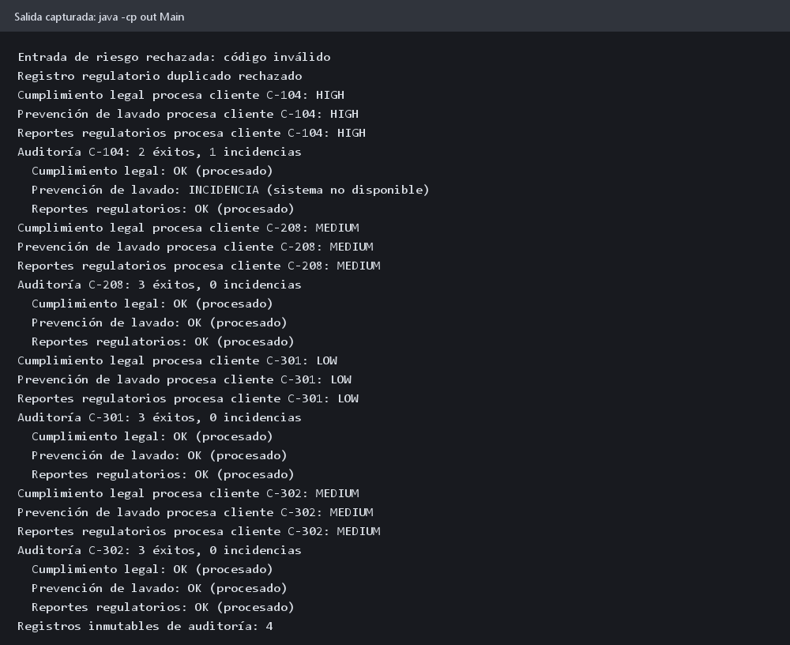

# Ejercicio 10 - Notificación empresarial de riesgo y cumplimiento

El servicio procesa observadores regulatorios obligatorios secuencialmente y
serializa cambios concurrentes mediante un `ReentrantLock`. Cada subsistema se
aisla con `try/catch`; la bitácora guarda un registro inmutable por cambio con
el resultado de todos los receptores. Los códigos de cliente y perfiles se
validan antes de procesarse.



La imagen reproduce la salida estándar de una ejecución real de `Main`.
Requiere Java 17 o posterior. Desde esta carpeta, compile y ejecute:

```powershell
javac -d out src\Main.java
java -cp out Main
```
