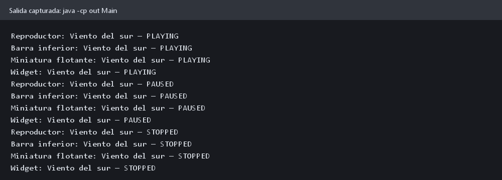

# Ejercicio 2 - Sincronizador de interfaz multimedia

El reproductor emite un estado inmutable al cambiar título o reproducción.
Tres vistas reciben cada actualización sin hacer *polling*; la lista de
oyentes usa `CopyOnWriteArrayList`.



La imagen reproduce la salida estándar de una ejecución real de `Main`.
Requiere Java 17 o posterior. Desde esta carpeta, compile y ejecute:

```powershell
javac -d out src\Main.java
java -cp out Main
```
