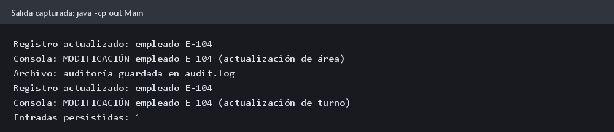

# Ejercicio 3 - Registro automático de auditoría

El registro de empleados publica eventos sin depender de las salidas. Los
oyentes de consola y archivo se suscriben dinámicamente; la segunda operación
se envía luego de retirar el auditor de archivo. El archivo temporal de la
demostración se elimina al finalizar.



La imagen reproduce la salida estándar de una ejecución real de `Main`.
Requiere Java 17 o posterior. Desde esta carpeta, compile y ejecute:

```powershell
javac -d out src\Main.java
java -cp out Main
```
