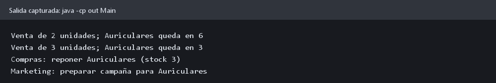

# Ejercicio 4 - Alertas de stock bajo

El producto protege su inventario, valida las ventas y notifica a los
departamentos solamente al alcanzar el umbral crítico. Cada observador decide
su acción a partir del evento recibido.



La imagen reproduce la salida estándar de una ejecución real de `Main`.
Requiere Java 17 o posterior. Desde esta carpeta, compile y ejecute:

```powershell
javac -d out src\Main.java
java -cp out Main
```
