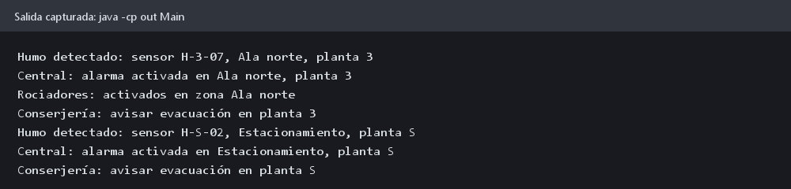

# Ejercicio 5 - Monitor de sensores de humo

Dos sensores publican alertas con ubicación exacta a dispositivos
independientes. Cada respuesta filtra la zona que le corresponde; incorporar
un nuevo sistema solo requiere implementar la interfaz `EmergencyResponse`.



La imagen reproduce la salida estándar de una ejecución real de `Main`.
Requiere Java 17 o posterior. Desde esta carpeta, compile y ejecute:

```powershell
javac -d out src\Main.java
java -cp out Main
```
