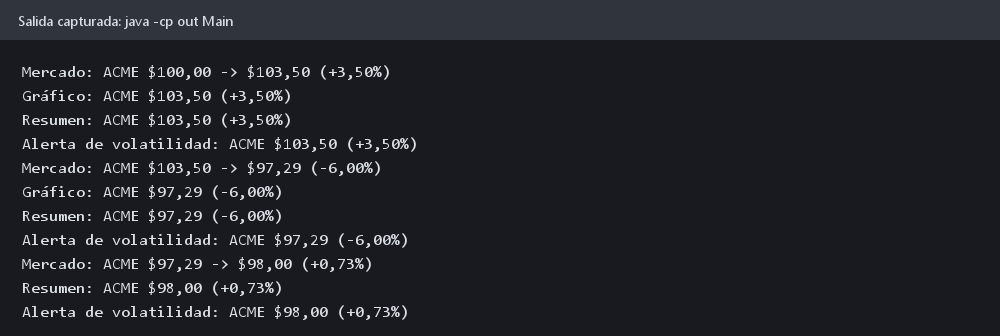

# Ejercicio 6 - Panel de cotizaciones bursátiles

El mercado emite un objeto de cotización inmutable con variación porcentual
respecto del precio anterior. `CopyOnWriteArrayList` permite recorrer una
instantánea segura mientras se modifica la suscripción.



La imagen reproduce la salida estándar de una ejecución real de `Main`.
Requiere Java 17 o posterior. Desde esta carpeta, compile y ejecute:

```powershell
javac -d out src\Main.java
java -cp out Main
```
