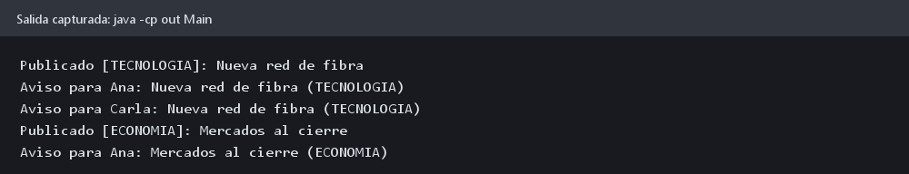

# Ejercicio 7 - Suscripción a canales de noticias

El portal enruta cada artículo únicamente al canal de su categoría. Un lector
puede seguir varios temas y cancelar una suscripción sin afectar las demás.
El mapa concurrente indexa listas seguras por tópico.



La imagen reproduce la salida estándar de una ejecución real de `Main`.
Requiere Java 17 o posterior. Desde esta carpeta, compile y ejecute:

```powershell
javac -d out src\Main.java
java -cp out Main
```
