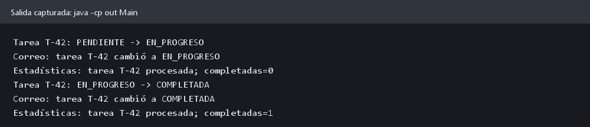

# Ejercicio 8 - Refactorización al patrón Observer

La tarea solo gestiona su propio estado y notifica una interfaz abstracta.
Correo y estadísticas son receptores independientes: la tarea no importa ni
invoca sus clases concretas.



La imagen reproduce la salida estándar de una ejecución real de `Main`.
Requiere Java 17 o posterior. Desde esta carpeta, compile y ejecute:

```powershell
javac -d out src\Main.java
java -cp out Main
```
