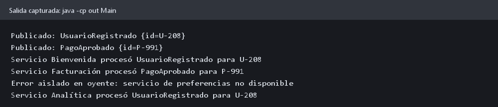

# Ejercicio 9 - Bus avanzado de eventos

El bus indexa oyentes por tipo de evento, despacha en un `ExecutorService` y
entrega payloads inmutables. Una excepción se aísla por oyente para que los
receptores siguientes continúen procesando el evento.



La imagen reproduce la salida estándar de una ejecución real de `Main`.
Requiere Java 17 o posterior. Desde esta carpeta, compile y ejecute:

```powershell
javac -d out src\Main.java
java -cp out Main
```
