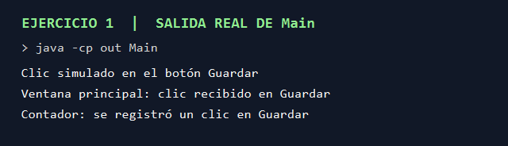

# Ejercicio 1 - Notificador de clic en botón

`Button` conserva una colección de oyentes bajo un contrato común y notifica a
todos al simular un clic; no conoce las ventanas ni sus implementaciones.

Desde esta carpeta, compila y ejecuta con:

```bash
javac -encoding UTF-8 -d out src/*.java
java -cp out Main
```

La captura corresponde a la salida real de esa ejecución:


