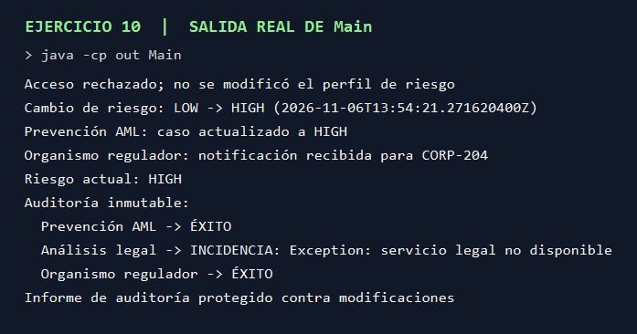

# Ejercicio 10 - Cumplimiento normativo y auditoría de riesgos

`RiskAccount` valida al operador antes de cambiar el estado y notifica en orden
secuencial a sus observadores regulatorios. Cada excepción queda aislada y
registrada en un informe inmutable, junto con los receptores atendidos. La
cuenta protege el estado y la lista de oyentes tolera modificaciones
concurrentes.

Desde esta carpeta:

```bash
javac -encoding UTF-8 -d out src/*.java
java -cp out Main
```


