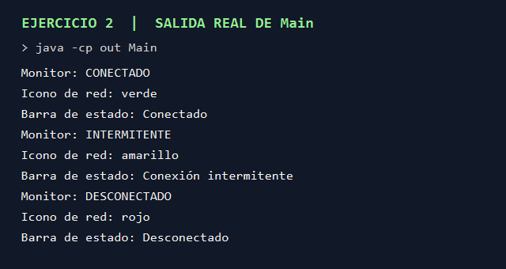

# Ejercicio 2 - Indicador de estado de conexión de red

`NetworkMonitor` notifica cambios de estado a un icono y una barra de estado,
sin sondeo periódico. La lista `CopyOnWriteArrayList` permite recorrer una
instantánea segura aunque haya cambios de suscriptores concurrentes.

Desde esta carpeta:

```bash
javac -encoding UTF-8 -d out src/*.java
java -cp out Main
```


