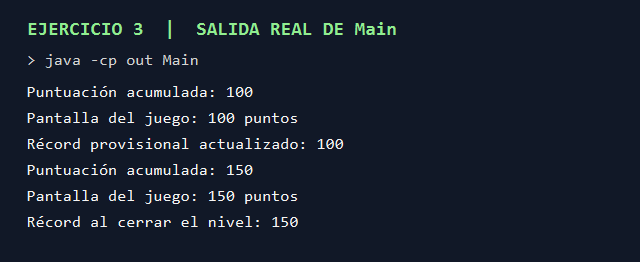

# Ejercicio 3 - Marcador de puntuación

`Scoreboard` actualiza el total y notifica a los oyentes sin depender de las
clases de pantalla ni del registro histórico. La demo elimina dinámicamente el
oyente de récords entre dos sumas.

Desde esta carpeta:

```bash
javac -encoding UTF-8 -d out src/*.java
java -cp out Main
```


