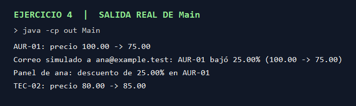

# Ejercicio 4 - Alertas de precio en lista de deseos

Cada `Product` encapsula su precio y su propia lista de canales suscritos.
Solo las reducciones generan un `PriceDrop` inmutable con el porcentaje
calculado; los aumentos no envían alertas.

Desde esta carpeta:

```bash
javac -encoding UTF-8 -d out src/*.java
java -cp out Main
```


