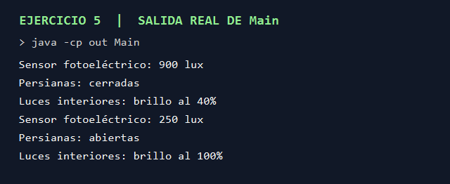

# Ejercicio 5 - Automatización según luz solar

El sensor publica cada medición a los actuadores suscritos. Las persianas y
las luces reaccionan sin que el sensor conozca esos dispositivos; ambos se
actualizan con cada cambio de luminosidad.

Desde esta carpeta:

```bash
javac -encoding UTF-8 -d out src/*.java
java -cp out Main
```


