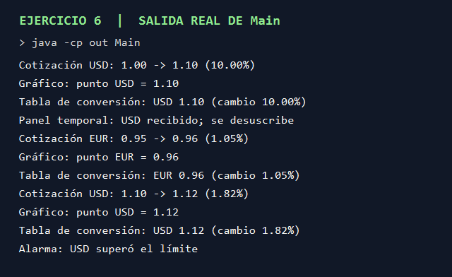

# Ejercicio 6 - Panel financiero de variación de divisas

`ExchangeMonitor` conserva cotizaciones por divisa y envía una estructura
`Quote` inmutable, con variación porcentual respecto del ciclo anterior, a
paneles suscritos. La lista de copia en escritura admite altas y bajas seguras
durante una notificación; el panel temporal se desuscribe desde su callback.

Desde esta carpeta:

```bash
javac -encoding UTF-8 -d out src/*.java
java -cp out Main
```


