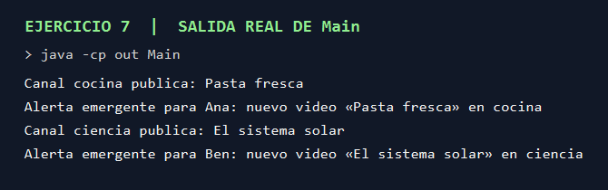

# Ejercicio 7 - Suscripción a canales de video

`StreamingPlatform` indexa los canales por identificador. Cada canal mantiene
sus propios seguidores y envía metadatos inmutables únicamente a quienes
siguen ese canal. La demo cancela una suscripción y publica en dos canales.

Desde esta carpeta:

```bash
javac -encoding UTF-8 -d out src/*.java
java -cp out Main
```


