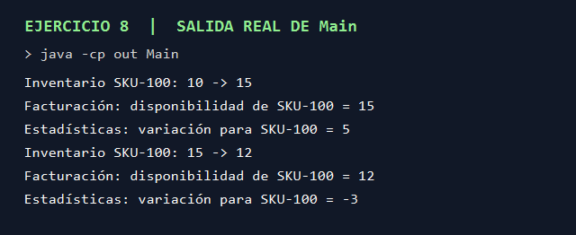

# Ejercicio 8 - Refactorización hacia eventos de inventario

`InventoryItem` solo valida y modifica su propio stock, y emite un evento
abstracto `StockChange`. Facturación y estadísticas son oyentes separados; el
inventario no mantiene referencias ni llamadas a esos módulos concretos.

Desde esta carpeta:

```bash
javac -encoding UTF-8 -d out src/*.java
java -cp out Main
```


