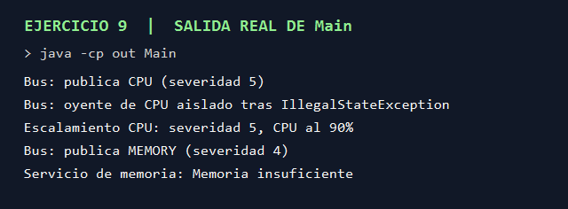

# Ejercicio 9 - Bus asíncrono de alertas de servidores

`AlertEventBus` enruta por categoría mediante un mapa concurrente y procesa
oyentes con un grupo de hilos. Cada callback está aislado: una excepción queda
registrada y no impide que los demás observadores reciban el evento. `publish`
devuelve un `CompletableFuture` para esperar el despacho en la demo.

Desde esta carpeta:

```bash
javac -encoding UTF-8 -d out src/*.java
java -cp out Main
```


